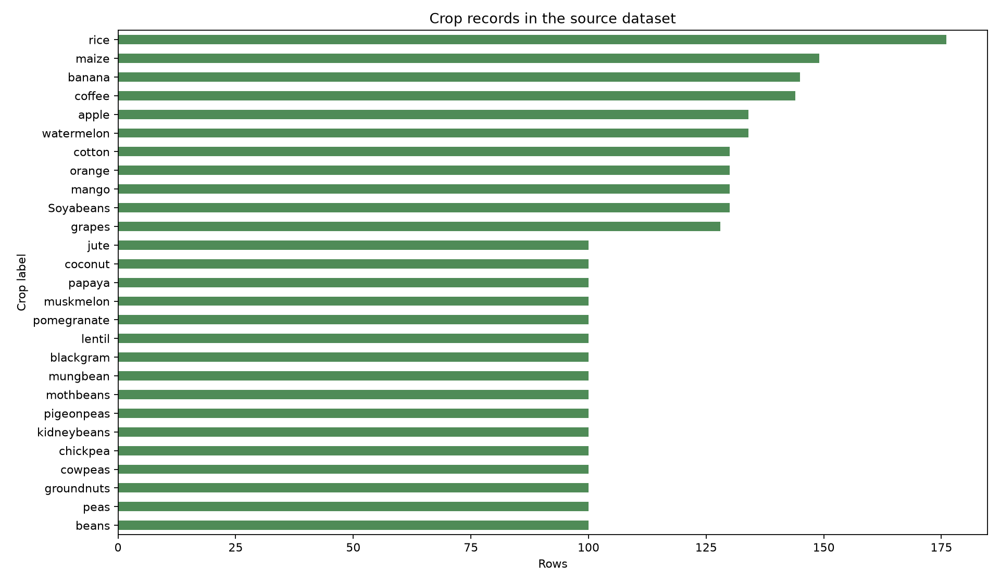
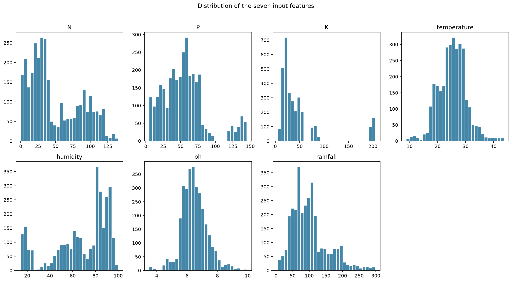
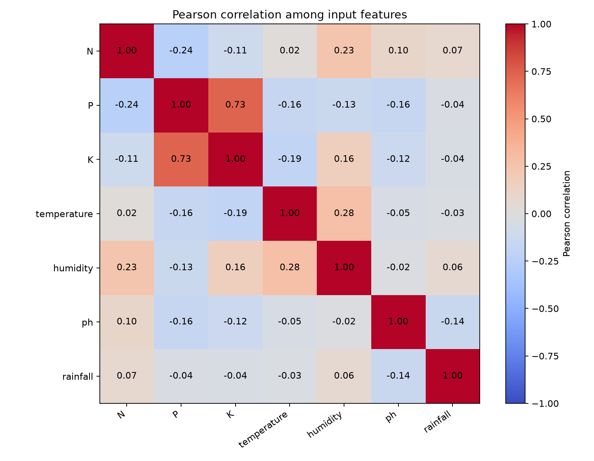
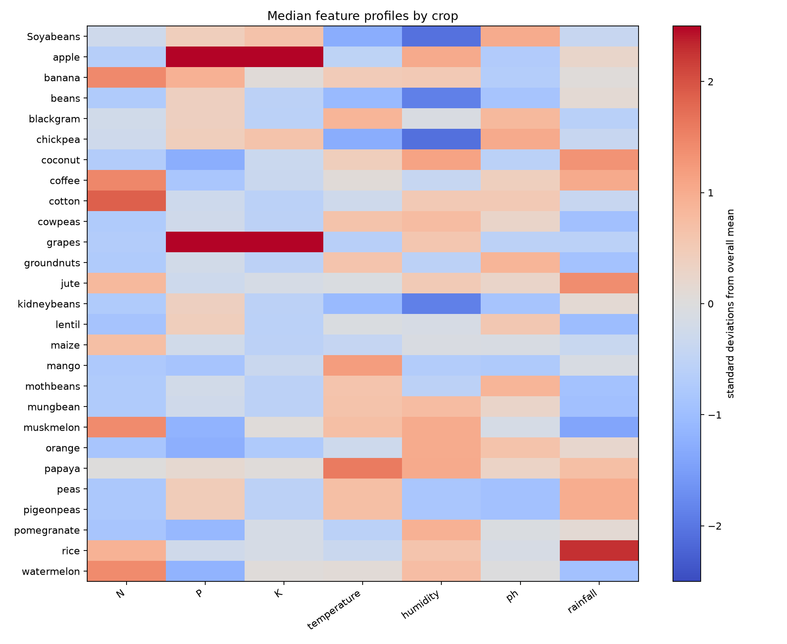

# Crop Suitability Exploratory Data Analysis

## Dataset shape and class mix

The preserved CSV contains 3,130 rows and 27 crop labels. Every label has at
least 100 rows. Rice has the most (176), followed by maize (149), banana (145),
and coffee (144). A count of 100 is the smallest class size, so the count ratio
is 1.76. The labels are not equally sized, but raw class imbalance alone does
not explain the most important error: many input profiles have contradictory
labels.

## Feature ranges and distributions

| Feature | Minimum | Median | Maximum | API-described unit (not in CSV) |
| --- | ---: | ---: | ---: | --- |
| N | 0.000 | 36.000 | 140.000 | kg/ha |
| P | 5.000 | 54.000 | 145.000 | kg/ha |
| K | 5.000 | 30.000 | 205.000 | kg/ha |
| Temperature | 8.826 | 25.401 | 43.675 | °C |
| Humidity | 14.258 | 77.680 | 99.982 | % |
| pH | 3.505 | 6.419 | 9.935 | pH units |
| Rainfall | 5.315 | 91.639 | 298.560 | mm |

There are no missing, non-finite, or broad-range-invalid values. The IQR screen
flags 550 rows for unusual values in at least one feature. These are retained:
the data has no source-level context to decide that a statistically rare
measurement is erroneous.

## Relationships and redundancy

Pearson correlation is strongest between P and K at 0.733. Other largest
relationships are temperature and humidity at 0.280, N and humidity at 0.235,
and N and P at −0.236. P and K therefore share some linear information, but are
not interchangeable. Correlation does not establish which measurement causes
or defines a crop label.

The crop median heatmap shows broad label patterns, such as rice having higher
rainfall than many classes and apple/grapes having high P and K medians. Several
legume labels have overlapping profiles, consistent with their observed
confusions. These are patterns in this table, not proof of crop requirements in
real farms.

The N/P scatter view shows the overall measurement distribution and overlap;
it is not colored by crop and cannot represent all seven dimensions. The
crop-median heatmap provides the crop-specific view. Full per-crop feature summaries are in
`../data_audit/feature_summary_by_crop.csv`; the raw correlation matrix is in
`../data_audit/feature_correlation_matrix.csv`.

## Duplicate, outlier, and suspicious-record analysis

There are no fully duplicated rows. However, 354 exact seven-feature profiles
are repeated under a different crop label (708 rows total). That is a direct
ambiguity in the input-to-label mapping, not a cleaning issue. Another 896
feature pairs are within 0.005 Euclidean distance after each feature is divided
by its fixed broad input-range width; 530 of those pairs carry different crop
labels. No row was removed.

The dataset has no farm, date, district, season, source-record ID, or collection
batch columns. Consequently, the audit cannot decide whether the repeated and
near-repeated rows are repeated measurements, synthetic augmentation,
aggregations, or separate but similar observations. A grouped split prevents
the same or very close profiles from appearing across partitions, which is a
more conservative evaluation, but it cannot repair contradictory labels.

## Generated figures and tables

- `../data_audit/figures/crop_class_counts.png`
- `../data_audit/figures/feature_distributions.png`
- `../data_audit/figures/feature_correlations.png`
- `../data_audit/figures/crop_feature_medians.png`
- `../data_audit/figures/nitrogen_phosphorus_distribution.png`
- `../data_audit/figures/validation_model_comparison.png`
