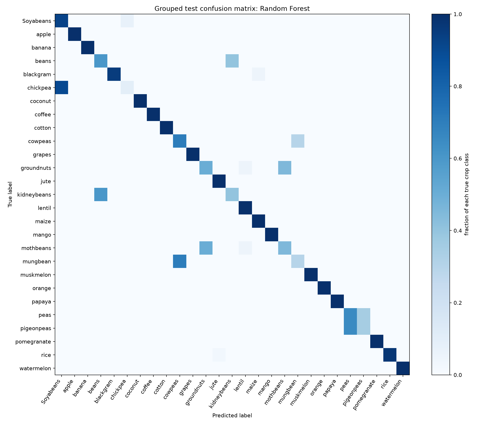

# Crop Suitability Final Evaluation

## Decision summary

On the grouped validation split, Random Forest had the highest macro F1
(0.7958), ahead of KNN (0.7846) and the current SVM design (0.7807). It is
therefore preserved as a separate review candidate at
`../../artifacts/crop_suitability_grouped_split_challenger_040c3feeea2b.joblib`. On the final
grouped test it scored 0.8357 accuracy and 0.8016 macro F1. The SVM reference
scored 0.8309 accuracy and 0.7918 macro F1 on the same test rows.

The candidate improves this benchmark slightly, but chickpea recall is only
0.10 for Random Forest and 0.00 for SVM. More fundamentally, identical inputs
carry conflicting crop labels and the exact dataset provenance and label
definition are unknown. **Keep the existing production SVM in place pending
review; neither model is ready to be treated as dependable farm advice.** No
production model artifact was replaced.

## Split and test-set handling

Validation and final test were separated before model fitting, using
stratified-group splits. Exact and very-near input profiles were grouped using
fixed broad input-range widths; no group appears across training, validation,
and test. The resulting row counts are 1,877 train, 626 validation, and 627
test. All 27 labels appear in all three partitions.

Five candidate configurations were fit on training rows. Selection used
validation macro F1, with accuracy only as a tie-breaker. The final test was
scored only after selection. It was not used for tuning, hyperparameter choice,
or candidate selection. The existing production pickle was trained on all
3,130 rows, so scoring that already-fitted artifact against this test would be
invalid. Instead, the SVM reference was rebuilt with the same RBF/scaler design
using only train plus validation rows.

## Candidate validation comparison

| Candidate | Train accuracy | Train macro precision | Train macro recall | Train macro F1 | Train weighted F1 | Validation accuracy | Validation macro precision | Validation macro recall | Validation macro F1 | Validation weighted F1 |
| --- | ---: | ---: | ---: | ---: | ---: | ---: | ---: | ---: | ---: | ---: |
| Random Forest | 0.8402 | 0.8176 | 0.8161 | 0.8119 | 0.8348 | **0.8307** | **0.8046** | **0.8069** | **0.7958** | **0.8196** |
| K-Nearest Neighbors | 0.8897 | 0.9271 | 0.8722 | 0.8553 | 0.8731 | 0.8131 | 0.7869 | 0.7916 | 0.7846 | 0.8068 |
| SVM, RBF | 0.8284 | 0.7852 | 0.8030 | 0.7914 | 0.8163 | 0.8195 | 0.7744 | 0.7955 | 0.7807 | 0.8053 |
| Decision Tree | 0.8402 | 0.7246 | 0.8148 | 0.7551 | 0.7860 | 0.8179 | 0.6987 | 0.7928 | 0.7320 | 0.7631 |
| Logistic Regression | 0.7890 | 0.6937 | 0.7648 | 0.7146 | 0.7413 | 0.7955 | 0.7014 | 0.7682 | 0.7175 | 0.7461 |

Per-class validation results and confusion matrices are in
`../data_audit/per_class_validation_*.csv` and
`../data_audit/confusion_matrix_validation_*.csv`.

## Final test results

| Final-report model | Accuracy | Macro precision | Macro recall | Macro F1 | Weighted F1 | Chickpea precision / recall / F1 (support 20) |
| --- | ---: | ---: | ---: | ---: | ---: | --- |
| Validation-selected Random Forest | 0.8357 | 0.8111 | 0.8109 | 0.8016 | 0.8257 | 0.5000 / 0.1000 / 0.1667 |
| Fixed SVM reference, same development rows | 0.8309 | 0.7879 | 0.8062 | 0.7918 | 0.8166 | 0.0000 / 0.0000 / 0.0000 |

Each of the 16 smallest classes has 20 test examples. Thus the per-class scores
are useful diagnostics, but a few errors change those recalls substantially.
The Random Forest correctly identified 2 of 20 chickpea records and classified
the other 18 as `Soyabeans`; the SVM reference classified all 20 as
`Soyabeans`. A crop-level cost matrix was not available, so these metrics do
not say how costly a false recommendation is compared with a missed suitable
crop.

Complete test metrics and every class's precision/recall/F1 are in
`../data_audit/final_test_results.json` and
`../data_audit/per_class_test_*.csv`. The test confusion matrices are saved as
CSV in the same evidence directory.

## Historical result versus this audit

The pre-existing `holdout_metrics.json` records the SVM's stratified random
80/20 result: accuracy 0.7987, macro F1 0.7565, and weighted F1 0.7866 on 626
rows. Reconstructing its seed-42 row split shows that 103 of 626 test rows
(16.5%) had an identical feature profile in the training rows. This is a
dependence flaw in that split. It does not prove the old score was inflated:
the grouped split is stricter in its grouping rule and produced similar
aggregate performance. The two results are not a controlled score comparison.

## Inference, reliability, and limitations

- The artifact expects exactly N, P, K, temperature, humidity, pH, rainfall in
  that order. The saved SVM includes `StandardScaler`; the inference helper
  does not apply a second scaler.
- The API checks broad physical ranges, but these are much wider than observed
  training support (for example, accepted rainfall up to 2,000 while the data
  ends at 298.56). There is no out-of-training-distribution warning.
- The SVM does not support calibrated probabilities. Its backend ranking uses
  decision-function scores, which are margin heuristics. The RF challenger can
  emit class scores, but they have not been calibrated and must not be described
  as real-world probability of suitability.
- The seven fields contain no location, season, irrigation, soil depth/type,
  planting calendar, local weather forecast, farm management, crop variety, or
  observed field outcome. No temporal or geographic generalization can be
  measured because those identifiers are absent.
- Exact input profiles with different labels put a ceiling on deterministic
  prediction from these seven features. This is especially visible in chickpea
  and overlapping legume classes.

## Recommendation

Retain the existing SVM production artifact until the project owner reviews the
evidence. Keep the grouped-split Random Forest as a separately named challenger
only; do not promote it based on this dataset alone. Any later production
decision should first establish the dataset source and label meaning, review
conflicting records, address chickpea recall, add realistic farm context, and
validate on independently collected farms or seasons. This report does not
approve artifact replacement or any new module.
