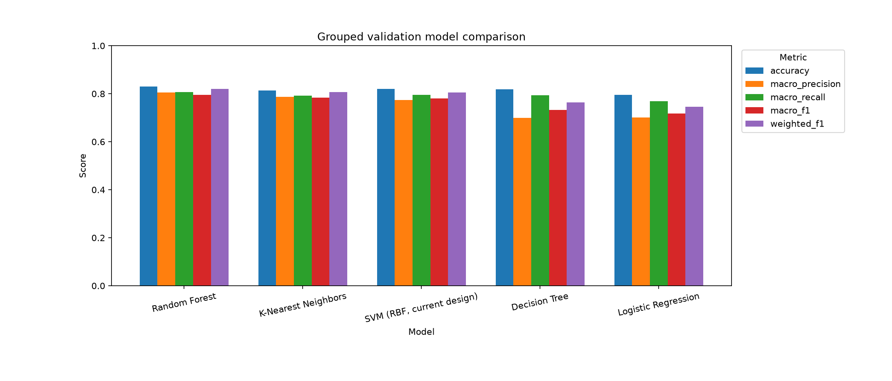

# Crop Suitability Model Comparison

## Evaluation design

The 3,130 rows were split into 1,877 training rows, 626 validation rows, and
627 final-test rows. Identical and near-identical feature profiles were grouped
first; all records in a group stay in one partition. Nearness uses a transparent
rule: divide each feature by its broad input-range width, then connect profiles
whose Euclidean distance is at most 0.005. This rule forms 2,264 groups, of
which 836 have multiple rows and 500 have more than one crop label. No group
crosses train, validation, and test.

Every partition contains all 27 classes. Training uses only its 1,877 rows.
Scaling for SVM, Logistic Regression, and KNN is inside a scikit-learn pipeline,
so the scaler is fitted only on training rows. Decision Tree and Random Forest
do not need scaling. The final test was held until the validation comparison
selected a model. No hyperparameter search was performed; these are readable
baseline configurations, not an exhaustive optimization.

The candidates cover distinct assumptions: Logistic Regression is a simple
linear baseline; SVM tests the existing nonlinear scaled classifier; KNN checks
local similarity; Decision Tree provides an interpretable nonlinear baseline;
and Random Forest tests a tree ensemble. The Random Forest used 400 trees,
`min_samples_leaf=2`, and random seed 42.

The rule selects by validation macro F1, with accuracy as a tie-breaker. Macro
F1 gives each crop equal weight, while weighted F1 reflects the observed class
counts. Accuracy alone can hide a complete failure for one crop.

## Training and validation results

| Candidate | Train accuracy | Train macro precision | Train macro recall | Train macro F1 | Train weighted F1 | Validation accuracy | Validation macro precision | Validation macro recall | Validation macro F1 | Validation weighted F1 |
| --- | ---: | ---: | ---: | ---: | ---: | ---: | ---: | ---: | ---: | ---: |
| Random Forest | 0.8402 | 0.8176 | 0.8161 | 0.8119 | 0.8348 | **0.8307** | **0.8046** | **0.8069** | **0.7958** | **0.8196** |
| K-Nearest Neighbors | 0.8897 | 0.9271 | 0.8722 | 0.8553 | 0.8731 | 0.8131 | 0.7869 | 0.7916 | 0.7846 | 0.8068 |
| SVM, RBF (current design) | 0.8284 | 0.7852 | 0.8030 | 0.7914 | 0.8163 | 0.8195 | 0.7744 | 0.7955 | 0.7807 | 0.8053 |
| Decision Tree | 0.8402 | 0.7246 | 0.8148 | 0.7551 | 0.7860 | 0.8179 | 0.6987 | 0.7928 | 0.7320 | 0.7631 |
| Logistic Regression | 0.7890 | 0.6937 | 0.7648 | 0.7146 | 0.7413 | 0.7955 | 0.7014 | 0.7682 | 0.7175 | 0.7461 |

Random Forest wins validation macro F1 by about 0.011 over KNN and 0.015 over
the current SVM design. Its training macro F1 is 0.016 higher than validation,
so this split does not show a large train/validation gap for the selected
candidate. KNN has a larger gap, which suggests more sensitivity to the
training rows. The Decision Tree has much lower macro precision and F1 than the
top two models.

Full precision and recall tables for every crop and every model are saved as
`../data_audit/per_class_validation_*.csv`. The confusion matrices are in
`../data_audit/confusion_matrix_validation_*.csv`.

## Chickpea and crop-level behavior

Chickpea has 20 validation and 20 test rows. On validation, Random Forest
recalls 2 of 20 chickpea rows (recall 0.10); KNN recalls 3 of 20 (0.15), while
Decision Tree, SVM, and Logistic Regression recall 0 of 20. Random Forest's
validation chickpea precision is 0.50, so half of the cases it labels chickpea
are correct. On the untouched test, Random Forest again recalls 2 of 20
(precision 0.50), while the SVM reference recalls 0 of 20. This is far below
the overall scores and makes chickpea recommendations particularly unsafe.

Validation scores are not uniformly strong across labels. Legumes such as
beans, cowpeas, groundnuts, peas, pigeonpeas, and the three bean classes are
among the difficult overlapping labels. See the per-class CSVs rather than
relying on the aggregate scores.

## Feature contribution and redundancy

Permutation importance was calculated on validation data for the winning
Random Forest and the existing SVM design. For Random Forest, humidity (mean
macro-F1 decrease 0.254), N (0.201), K (0.146), and rainfall (0.117) were the
largest contributions in this run. Temperature and pH had small changes
(0.016 and 0.010). P and K are correlated at 0.733, so their individual
permutation scores should not be interpreted as independent causal effects.
This method is a model reliance check, not proof that a feature is agronomically
necessary. Values and variation across 20 shuffles are in
`../data_audit/validation_permutation_importance.csv`.

## Candidate recommendation

Keep the current production SVM untouched until the review is complete. The
grouped validation evidence favors Random Forest for this dataset and the
separate candidate is preserved at
`../../artifacts/crop_suitability_grouped_split_challenger_040c3feeea2b.joblib`. The untouched
test report is documented separately. Neither candidate is established for
farm-specific use because source provenance, label definition, farm context,
and real-world outcome validation are missing.
