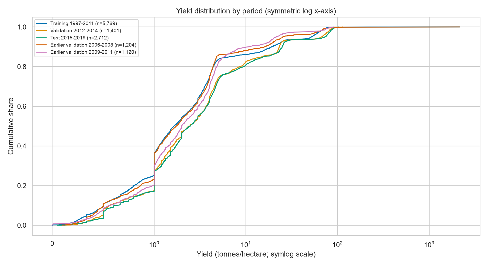
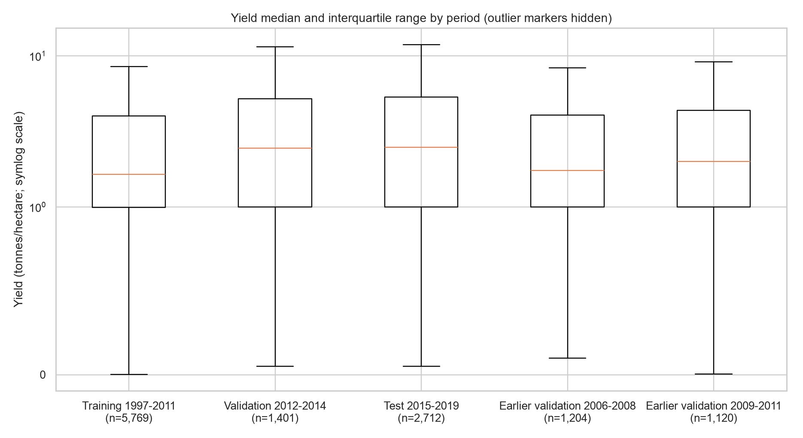
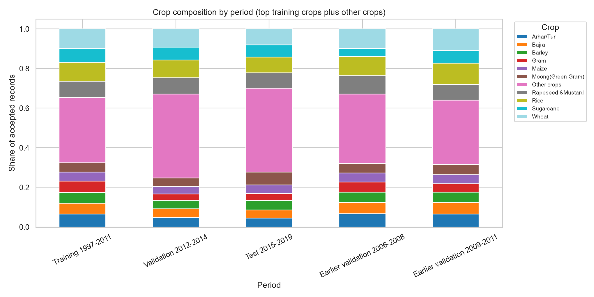
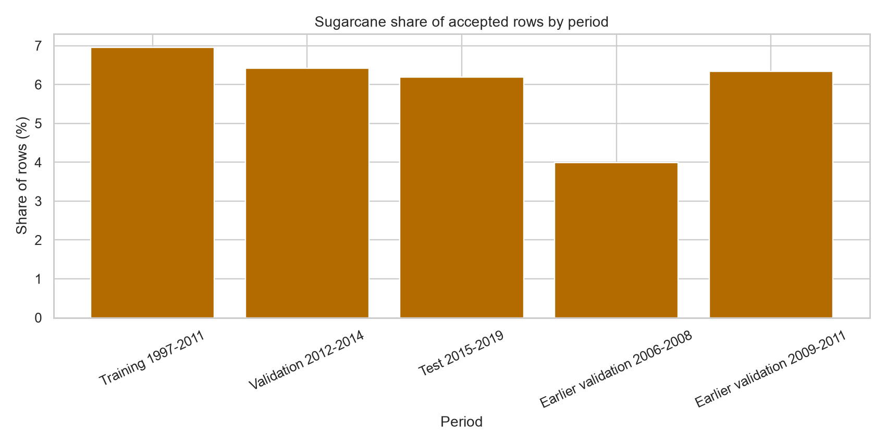

# Crop Yield — Final Data and Generalization Audit

## Scope

This audit uses the accepted primary dataset only: 9,882 rows from DataSets/Yeild/crop_production_haryana_punjab_1997_2019.csv. It keeps the original source untouched and retains source CSV row numbers for the extreme-record audit. The review evaluates validation errors on 2012-2014 and earlier historical validation windows. Test-period rows are used for descriptive target/crop-distribution summaries only; they are not used to tune or select a model.

The reproducible script is evaluation/data_generalization_audit.py. Machine-readable results and CSV tables are in this directory.

## Target distribution by time

Yield has a heavy right tail. The 2,150 t/ha Onion record in 2008-09 raises both the full training-period standard deviation and its maximum. The median and upper percentiles also rise in later periods, so the shift is not explained by that one record alone.

| Period | Rows | Mean | Median | Std dev | Min | Max | P01 | P05 | P25 | P75 | P90 | P95 | P99 |
|---|---:|---:|---:|---:|---:|---:|---:|---:|---:|---:|---:|---:|
| Training 1997-2011 | 5,769 | 7.404 | 1.639 | 32.154 | 0.002 | 2,150.000 | 0.168 | 0.333 | 0.997 | 4.005 | 19.058 | 52.121 | 70.172 |
| Validation 2012-2014 | 1,401 | 9.183 | 2.445 | 18.636 | 0.050 | 113.680 | 0.300 | 0.499 | 1.000 | 5.176 | 23.236 | 67.000 | 86.000 |
| Test 2015-2019 | 2,712 | 9.613 | 2.478 | 19.438 | 0.051 | 103.000 | 0.286 | 0.500 | 1.000 | 5.345 | 24.910 | 72.931 | 88.963 |
| Earlier window 2006-2008 | 1,204 | 7.771 | 1.746 | 63.234 | 0.099 | 2,150.000 | 0.233 | 0.390 | 1.000 | 4.039 | 16.105 | 25.437 | 70.357 |
| Earlier window 2009-2011 | 1,120 | 5.509 | 2.000 | 12.011 | 0.005 | 91.309 | 0.176 | 0.428 | 1.000 | 4.364 | 10.901 | 21.622 | 74.645 |

P01 is in the full CSV. In a sensitivity calculation only, excluding the single 2,150 t/ha record (without changing or recommending deletion of it) moves training mean/std from 7.404/32.154 to 7.033/15.424. In 2006-2008, mean/std move from 7.771/63.234 to 5.990/13.445. This observation is the main reason early validation RMSE is so unstable.

## Crop composition

The crop mix is statistically different across the disjoint training, validation, and test periods: chi-square 765.83, 52 degrees of freedom, p=1.31e-127. For the test, crop categories with fewer than 50 total accepted rows were pooled; the minimum expected cell count was 7.94. Cramer's V is 0.197, so the period association is measurable but not a claim that crop mix alone explains the model errors. Large sample sizes make p-values small; the size and practical meaning of the share changes matter too.

There are 33 distinct crops in training, 31 in validation, and 28 in test. Top shares illustrate the shift:

| Crop | Training share | Validation share | Test share |
|---|---:|---:|---:|
| Wheat | 9.85% | 9.21% | 8.04% |
| Rice | 9.55% | 8.99% | 7.85% |
| Rapeseed & Mustard | 8.32% | 8.21% | 7.78% |
| Sugarcane | 6.95% | 6.42% | 6.19% |
| Peas & beans (Pulses) | 2.82% | 5.64% | 7.34% |
| Moong (Green Gram) | 4.90% | 2.57% | 6.42% |

Sugarcane's record share is slightly lower in later periods; its extreme yield level still has a major effect on absolute errors. Crop proportions therefore do not explain the Sugarcane error by themselves.

One crop label, other oilseeds, is absent from 1997-2011 training and appears 3 times in validation and 28 times in test. Four crop-season combinations in the later data also do not occur in training; together they account for 54 validation rows and 213 test rows. These are out-of-support predictions. The inference helper rejects an unknown category, while a raw OneHotEncoder configured to ignore unknowns maps it to an all-zero category block. Neither behavior supplies evidence that these estimates are reliable.

The target also shifts **within crop**, so the change is not only a different crop mix. Examples (mean / median t/ha):

| Crop | Training 1997-2011 | Validation 2012-2014 | Test 2015-2019 |
|---|---:|---:|---:|
| Sugarcane | 55.37 / 58.78 | 75.35 / 75.38 | 79.91 / 80.00 |
| Wheat | 4.21 / 4.24 | 4.44 / 4.54 | 4.77 / 4.79 |
| Rice | 3.19 / 3.19 | 3.45 / 3.52 | 3.54 / 3.66 |
| Peas & beans (Pulses) | 1.24 / 1.16 | 4.41 / 5.36 | 5.90 / 5.35 |

For the crop-season-only tree, the training-period Sugarcane mean is exactly about 55.37 t/ha; 2012-2014's mean is 75.35. Because the tree has no year, district, or field feature, it predicts the historical crop-season level and cannot follow that rise. The Sugarcane underprediction is therefore consistent with a temporal within-crop shift, in addition to high source values.

Full crop counts, shares and within-crop yield summaries are in crop_composition_by_period.csv, crop_counts_by_period_wide.csv, crop_shares_by_period_wide.csv, and yield_by_crop_and_period.csv.

## Extreme source observations and unit audit

I reviewed the 100 largest accepted yields against their exact source CSV rows. All 100 have Area Units = Hectare, Production Units = Tonnes, and Yield equals Production/Area within numeric tolerance. That verifies only the arithmetic and labels inside this file; it does **not** independently verify the reported area or production.

Of those 100:

- 94 are arithmetically and unit-consistent and do not exceed the crop-specific IQR fence.
- 4 are crop-specific IQR flags requiring source-owner confirmation, although their ratios and units match.
- 2 are suspicious screening flags because very small areas produce extremely large yields. Their ratios still match, so this is not proof the source values are wrong.

| Source CSV row | Crop / district / year | Area | Production | Yield t/ha | Review |
|---:|---|---:|---:|---:|---|
| 3,993 | Onion, Karnal, 2008-09 | 2 ha | 4,300 tonnes | 2,150.000 | Suspicious: extreme yield with tiny denominator; arithmetic matches. |
| 700 | Potato, Panipat, 2002-03 | 195 ha | 41,700 tonnes | 213.846 | Crop-IQR outlier; source confirmation needed. |
| 11,565 | Sugarcane, Gurgaon, 1998-99 | 306 ha | 50,000 tonnes | 163.399 | Crop-IQR outlier; source confirmation needed. |
| 5,995 | Sugarcane, Panchkula, 2012-13 | 519 ha | 59,000 tonnes | 113.680 | Crop-IQR outlier; source confirmation needed. |
| 5,961 | Sugarcane, Faridabad, 2012-13 | 668 ha | 74,000 tonnes | 110.778 | Crop-IQR outlier; source confirmation needed. |
| 4,331 | Sugarcane, Panchkula, 2008-09 | 413 ha | 44,000 tonnes | 106.538 | Arithmetic consistent; not independently validated. |
| 9,742 | Sugarcane, Barnala, 2016-17 | 1,000 ha | 103,000 tonnes | 103.000 | Arithmetic consistent; not independently validated. |
| 9,773 | Sugarcane, Patiala, 2017-18 | 2,000 ha | 204,000 tonnes | 102.000 | Arithmetic consistent; not independently validated. |
| 2,606 | Sugarcane, Fatehabad, 2006-07 | 644 ha | 65,000 tonnes | 100.932 | Arithmetic consistent; not independently validated. |
| 11,309 | Potato, Jhajjar, 1999-00 | 1 ha | 100 tonnes | 100.000 | Suspicious: extreme yield with tiny denominator; arithmetic matches. |

No observation was removed. The IQR fence is a review flag, not an agricultural validity test. No source provenance link or independent measurement is available locally, so none of the top records can be called externally verified. The full 100-row source audit is largest_source_records_audit.csv, with separate arithmetic-consistent, suspicious, and follow-up lists.

The primary dataset also contains 130 accepted rows labelled District = S, all Punjab, spanning 2006-07 through 2019-20. This one-letter label may be an aggregate or placeholder, but its meaning is undocumented. It remains in the data and should be clarified with the source owner. See ambiguous_district_labels.csv.

## Regional and subgroup generalization

The following scores are from models fitted through 2011 and evaluated on 2012-2014 validation only. They are diagnostic slices, not separate retrained regional models. The Crop+Season Decision Tree has no region input, so its state/district results measure where its crop-season estimates miss, not learned district effects.

| Model / group | Validation rows | MAE | RMSE |
|---|---:|---:|---:|
| Crop+Season Decision Tree — Haryana | 900 | 2.648 | 6.142 |
| Crop+Season Decision Tree — Punjab | 501 | 2.317 | 6.939 |
| Crop+Season Decision Tree — Sugarcane | 90 | 20.464 | 23.223 |
| Crop+Season Decision Tree — Whole Year | 366 | 7.903 | 12.390 |
| Crop+Season Decision Tree — Kharif | 592 | 0.814 | 1.728 |
| Crop+Season Decision Tree — Rabi | 443 | 0.384 | 0.526 |
| All-six Random Forest — Haryana | 900 | 12.809 | 59.943 |
| All-six Random Forest — Punjab | 501 | 1.354 | 3.993 |
| All-six Random Forest — Turmeric | 31 | 64.944 | 170.370 |
| All-six Random Forest — Sugarcane | 90 | 34.729 | 43.865 |
| All-six Random Forest — Whole Year | 366 | 22.929 | 71.378 |

For the Decision Tree, supported district slices with the highest MAE include Panipat (39 rows, 4.118), Kaithal (39, 4.007), and Karnal (46, 3.747). These are still small, three-year aggregates. Only groups with at least 30 validation records receive error metrics in the audit. Groups below that threshold receive counts only; examples include Ginger (6), Sannhamp (4), other oilseeds (3), Charki Dadri (2), and Faridkot (12). The same 30-row rule is applied to both models. Complete group outputs are validation_group_metrics_n30plus.csv and validation_groups_low_count.csv.

The dramatic differences for the all-six Random Forest and the Tree's Sugarcane/Whole Year slices point to interactions among high yields, sparse crop-region combinations, and year-to-year composition. Group metrics do not establish which individual record is erroneous.

## Previously recorded final-test results

This audit did not re-fit, tune, or select models using 2015-2019. The saved out-of-time evaluation files from the earlier review report a Decision Tree trained through 2014 at MAE 2.4032, RMSE 6.2134, R² 0.8978 on 2015-2019, and the production Random Forest evaluation at MAE 2.0995, RMSE 9.2745, R² 0.7723. These are historical recorded evaluations from models fitted before the final-test years, not scores from the current all-years-refit artifact. The challenger artifact itself was later refit on all 1997-2019 rows, so it must not be scored against those same test rows.

## Supported use and limitations

- **Historical aggregate estimation:** supported for crops/periods represented in the source, with outlier and data-quality caveats.
- **Crop-season average:** supported as a descriptive baseline; the tree challenger approximates a learned crop-season typical value. Sugarcane and Whole Year errors show why even this is not uniformly reliable.
- **District-level estimation:** the source has district labels, but this audit finds weak provenance, sparse groups, and the unresolved S label. The Crop+Season Tree cannot provide district-specific estimates. The six-feature Random Forest's validation scores are not reliable enough for a production district estimate.
- **Farm-specific estimation:** unsupported. There are no farm identifiers, parcel measurements, matched historical weather, soil, irrigation, or management features. A district crop record is not a farm observation.

Recommendation: do not promote the Decision Tree or describe either model as farm-specific. Keep the Random Forest artifact in place as requested, while treating its poor all-six validation results as a risk. Verify source provenance, resolve the district label S and flagged source rows, and obtain aligned environmental/field-level data before claiming reliable generalization. No model artifact was changed by this audit.

## Reproduction

Run from the repository root:

MPLCONFIGDIR=/private/tmp/agrioptima-mpl .venv/bin/python models/crop_yield/evaluation/data_generalization_audit.py

The script writes only audit tables, plots and JSON under evaluation/data_audit/. It does not write model artifacts.
